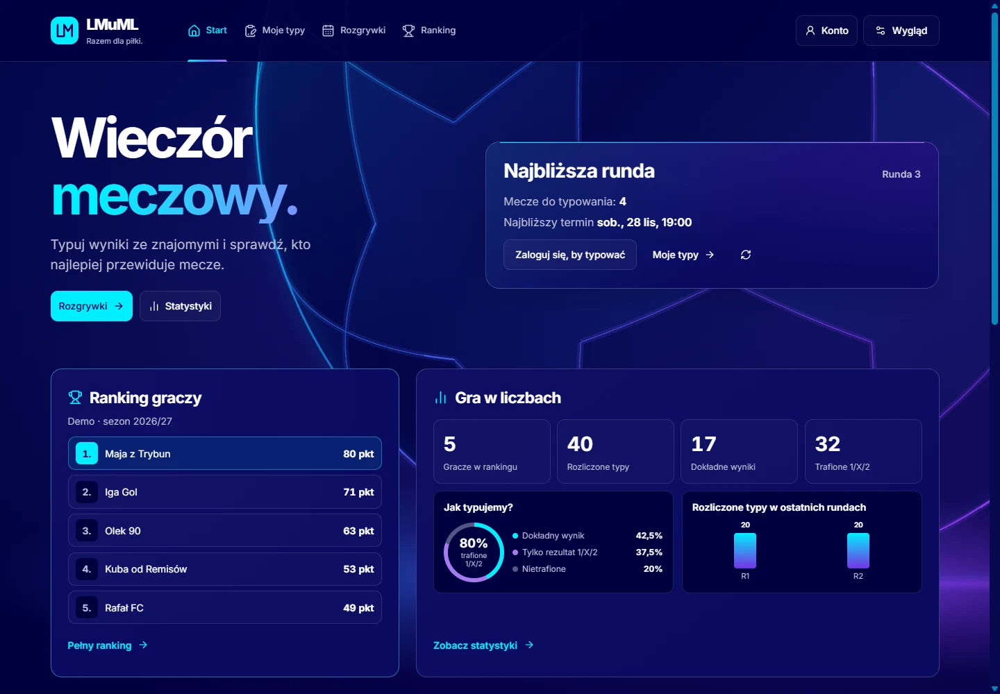

# LMuML

Aplikacja do wspólnego typowania wyników piłkarskich. Gracz uzupełnia typy całej rundy, śledzi swoje punkty i porównuje wyniki z innymi w rankingu. Termin zamknięcia ustala backend osobno dla każdego meczu.

## Zobacz aplikację



| Typowanie na telefonie | Ranking i punkty |
| --- | --- |
| [](docs/demo/typowanie-mobile.webp) | [](docs/demo/ranking-desktop.webp) |

[Obejrzyj krótki przebieg gracza](docs/demo/przebieg-gracza.webp) od wpisania typu na telefonie do zapisu i otwarcia rankingu. Zrzuty i nagranie pochodzą z działającego buildu na fikcyjnych drużynach i kontach. [Opis demonstracji](docs/demo/README.md).

## Co działa

- **Typowanie.** Rejestracja, logowanie i zapis kilku typów jednym przyciskiem. Gracz może edytować zapisany typ do rozpoczęcia meczu.
- **Punktacja i historia.** Ranking sezonu i rundy, ujawnione typy, statystyki graczy oraz wykresy. Punkty odnoszą się do regulaminowego wyniku po 90 minutach z doliczonym czasem. [Reguły gry](docs/decisions/0007-prediction-score-and-deadline.md).
- **Rozgrywki.** Terminarz, tabela fazy ligowej, drabinka i szczegóły meczu. Dostępne dane mogą obejmować zdarzenia, składy oraz statystyki zawodników.
- **Administracja.** Wybór aktywnego sezonu, publikacja własnych rund opartych o dni meczowe i stan synchronizacji wyników.
- **Dostępność.** Widoki na telefon i desktop, obsługa klawiatury, widok komfortowy i ograniczenie ruchu.

## Uruchom demo

Potrzebujesz Dockera z Compose. Z katalogu repozytorium wykonaj:

```sh
docker compose -f deploy/rehearsal/compose.yaml build
docker compose -f deploy/rehearsal/compose.yaml up --detach --wait
```

Otwórz [localhost:8443](https://localhost:8443). To środowisko ma osobną bazę, syntetyczne mecze i lokalny certyfikat HTTPS. Załóż konto z adresem w domenie `example.test`, wybierz **Moje typy** i zapisz wynik. Instrukcja opisuje weryfikację certyfikatu oraz test całej ścieżki. [Próbne wdrożenie](docs/operations/rehearsal.md).

## Architektura

| Część | Odpowiedzialność |
| --- | --- |
| [`frontend/`](frontend/) | React i TypeScript, podział na funkcje, komponenty shadcn/ui, walidacja odpowiedzi przez Zod |
| [`backend/`](backend/) | Java 25, Spring Boot, pakiety według domeny, jawne zapytania przez JdbcClient i migracje Flyway |
| [`scripts/`](scripts/) | Przygotowanie lokalnej bazy, kontrola środowiska i obsługa cyklu importu |
| [`deploy/rehearsal/`](deploy/rehearsal/) | Osobny start migracji, danych demo i aplikacji za Caddy |

Po imporcie Spring wysyła przez WebSocket wersję terminarza. React pobiera pełne dane przez REST po wykryciu zmiany. PostgreSQL pozostaje źródłem prawdy, a Redis przechowuje odbudowywalny cache publicznego katalogu. [Mapa architektury](docs/architecture.md) · [Decyzje techniczne](docs/decisions/README.md).

## Jakość i stan wydania

[CI](.github/workflows/ci.yml) sprawdza frontend, skrypty Node i backend z PostgreSQL oraz Redis w Testcontainers. Po testach buduje oba obrazy i sprawdza rejestrację, typ oraz WSS przez HTTPS. Środowisko demonstracyjne działa lokalnie. [Rozwój i uruchomienie](docs/development/local-environment.md) · [Plan publikacji](docs/operations/deployment-plan.md).
