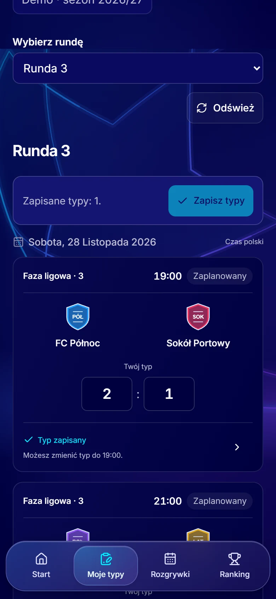
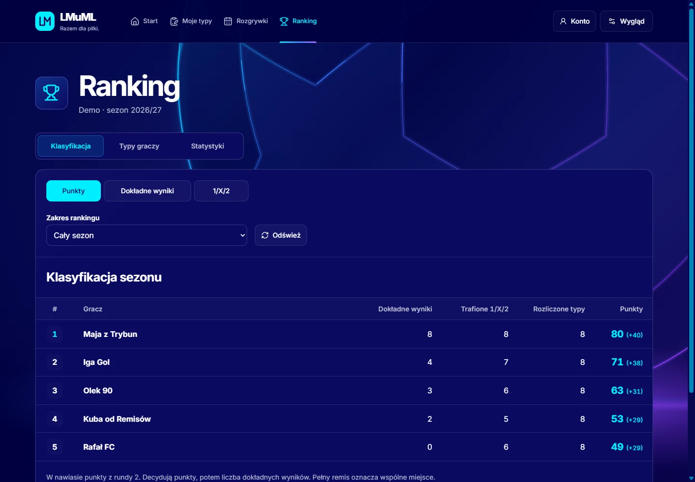

# LMuML

A full-stack app for predicting football scores with friends. Players can submit their picks for a whole round, track their points, and compare results in the standings. The backend enforces the deadline separately for each match.

## See it in action


| Mobile predictions | Player standings |
| --- | --- |
| [](docs/demo/typowanie-mobile.webp) | [](docs/demo/ranking-desktop.webp) |

[Watch the player walkthrough](docs/demo/przebieg-gracza.webp) to see a prediction edited and saved, followed by a visit to the rankings. The recording and screenshots come from a running build with fictional clubs and accounts. [Demo details](docs/demo/README.md).

## Features

- **Predictions.** Register, sign in, and save multiple picks together. Edit a saved prediction until kickoff.
- **Scoring and history.** Season and round rankings, revealed picks, and player statistics. Scoring uses the result after 90 minutes plus stoppage time. [Scoring and deadlines](docs/decisions/0007-prediction-score-and-deadline.md).
- **Fixtures.** Schedule, league table, knockout bracket, and match details. Available data can include events, lineups, and player statistics.
- **Administration.** Choose the active season, publish custom prediction rounds by matchday, and monitor fixture sync.
- **Accessibility.** Responsive layouts, keyboard navigation, comfort mode, and reduced motion.

## Run the demo

With Docker and Compose running, use these commands from the repository root:

```sh
docker compose -f deploy/rehearsal/compose.yaml build
docker compose -f deploy/rehearsal/compose.yaml up --detach --wait
```

Open [localhost:8443](https://localhost:8443). The demo has an isolated database, fictional fixtures, and a local HTTPS certificate. Register an address under `example.test`, select **Moje typy** (My predictions), and save a score. The walkthrough covers local certificate trust and an automated end-to-end check. [Deployment rehearsal](docs/operations/rehearsal.md).

## Architecture

| Area | Responsibility |
| --- | --- |
| [`frontend/`](frontend/) | React and TypeScript, feature-based modules, shadcn/ui, and Zod validation |
| [`backend/`](backend/) | Java 25, Spring Boot, feature packages, JdbcClient queries, and Flyway migrations |
| [`scripts/`](scripts/) | Local database setup, diagnostics, and the fixture import cycle |
| [`deploy/rehearsal/`](deploy/rehearsal/) | Flyway, demo data, and the application behind Caddy |

After an import, Spring sends the new fixture revision over WebSocket. React fetches the updated data through REST. PostgreSQL is the source of truth, and Redis caches the public fixture catalog. [Architecture guide](docs/architecture.md) · [Architecture decisions](docs/decisions/README.md).

## Quality checks

[CI](.github/workflows/ci.yml) checks the frontend, Node scripts, and backend with PostgreSQL and Redis in Testcontainers. It then builds both images and verifies signup, prediction persistence, and WSS over HTTPS. The application is available as a local demo. [Documentation index](docs/README.md).
