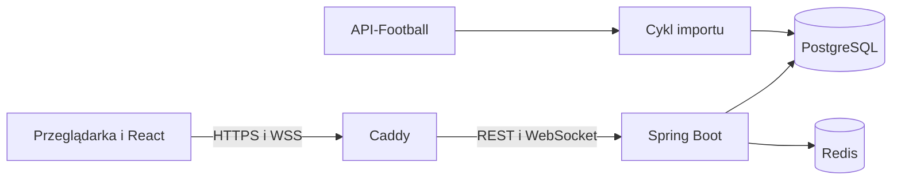

# Architektura LMuML

LMuML jest modularnym monolitem. Spring Boot udostępnia interfejs HTTP i WebSocket w jednym procesie. Frontend React korzysta z tej samej domeny przez reverse proxy. Wersje Javy i Node są przypięte w `mise.toml`.

## Gdzie szukać

| Obszar | Kod |
| --- | --- |
| Katalog sezonu, wyniki, WebSocket i cache odczytu | [`football/matches`](../backend/src/main/java/pl/lmuml/football/matches/) |
| Ustawienie sezonu i stan synchronizacji | [`football/seasons`](../backend/src/main/java/pl/lmuml/football/seasons/) |
| Klient dostawcy, DTO, mapowanie i import snapshotów | [`football/apifootball`](../backend/src/main/java/pl/lmuml/football/apifootball/) |
| Budowa i publikacja rund | [`bettingrounds`](../backend/src/main/java/pl/lmuml/bettingrounds/) |
| Konta, trwały zapis, punktacja i ranking | [`player`](../backend/src/main/java/pl/lmuml/player/) |
| Sesje, CSRF i reguły autoryzacji | [`security`](../backend/src/main/java/pl/lmuml/security/) |
| Widoki, kontrakty API i lokalny stan funkcji | [`frontend/src/features`](../frontend/src/features/) |

## Przepływy i decyzje

**Zapis typu.** React wysyła zestaw typów z sesją oraz tokenem CSRF. Spring weryfikuje gracza, przynależność meczu do opublikowanej rundy i termin rozpoczęcia. Zapis i reguły współbieżności egzekwuje w transakcji PostgreSQL. Czyste reguły punktacji wyznaczają punkty przy odczycie zakończonego meczu. [Punktacja i termin](decisions/0007-prediction-score-and-deadline.md).

**Import i aktualizacja.** Adapter waliduje próbkę dostawcy i mapuje ją na własne rekordy. Import zapisuje wynik i czas jego wersji w tej samej transakcji. WebSocket ogłasza wersję, a React wznawia odczyt REST także po odzyskaniu połączenia. [Import](decisions/0010-offline-catalog-import.md) · [WebSocket](decisions/0013-season-result-websocket.md).

**Cache-aside katalogu.** Aplikacja odczytuje wersje meczów i tabeli z PostgreSQL. Na ich podstawie może użyć wpisu Redis. Przy braku wpisu składa katalog z bazy. Niedostępność Redis nie odbiera użytkownikom dostępu do wyników. [Cache](decisions/0014-season-catalog-cache.md).

**Granice wdrożenia.** Migrator, importer i API mają oddzielne role bazy. Testy integracyjne tworzą osobny PostgreSQL i Redis. Próba Compose weryfikuje migracje, odczyt, logowanie, zapis i aktualizacje za proxy HTTPS. [Próbne wdrożenie](operations/rehearsal.md).
