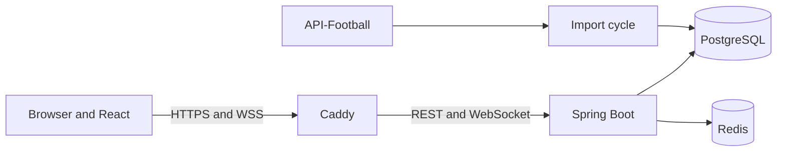

# LMuML architecture

LMuML is a modular monolith. Spring Boot serves HTTP and WebSocket endpoints in one process. The React frontend calls the same origin through a reverse proxy. Java and Node versions are pinned in `mise.toml`.

## Code map

| Area | Code |
| --- | --- |
| Fixture catalog, live revisions, and read cache | [`football/matches`](../backend/src/main/java/pl/lmuml/football/matches/) |
| Active season and sync status | [`football/seasons`](../backend/src/main/java/pl/lmuml/football/seasons/) |
| Provider client, DTOs, mapping, and snapshot import | [`football/apifootball`](../backend/src/main/java/pl/lmuml/football/apifootball/) |
| Prediction round planning and publication | [`bettingrounds`](../backend/src/main/java/pl/lmuml/bettingrounds/) |
| Accounts, prediction persistence, scoring, and rankings | [`player`](../backend/src/main/java/pl/lmuml/player/) |
| Sessions, CSRF, and authorization | [`security`](../backend/src/main/java/pl/lmuml/security/) |
| Feature views, API contracts, and local state | [`frontend/src/features`](../frontend/src/features/) |

## Main flows

**Submitting a prediction.** React posts a batch with a session and CSRF token. Spring checks the player, the match's published round, and kickoff. A PostgreSQL transaction enforces the write rules under concurrent use. Pure scoring rules calculate points when a settled match is read. [Scoring and deadlines](decisions/0007-prediction-score-and-deadline.md).

**Import and refresh.** The provider adapter validates each snapshot and maps it to application records. The importer stores the result and its revision in one transaction. WebSocket announces the revision, and React reconciles it with a REST response, including after reconnection. [Import](decisions/0010-offline-catalog-import.md) · [WebSocket](decisions/0013-season-result-websocket.md).

**Catalog cache-aside.** Spring checks fixture and standings revisions in PostgreSQL before reading a Redis entry. On a miss or Redis failure, it reads the complete catalog from PostgreSQL. [Catalog cache](decisions/0014-season-catalog-cache.md).

**Deployment boundary.** The migration job, importer, and API use separate database roles. Integration tests use isolated PostgreSQL and Redis containers. The Compose rehearsal verifies migrations, browsing, login, prediction persistence, and live updates through HTTPS. [Deployment rehearsal](operations/rehearsal.md).
